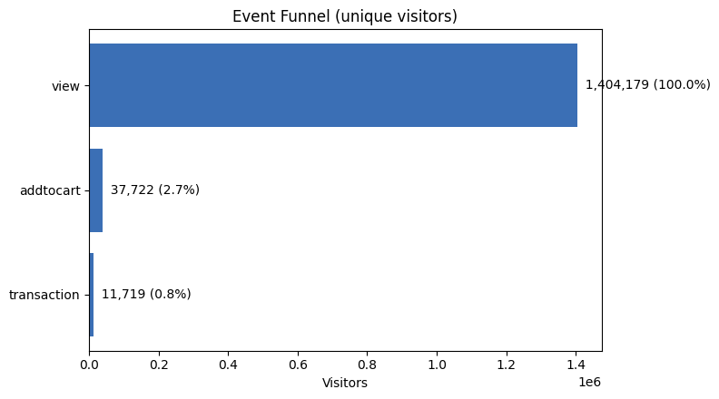

# RetailRocket

**이벤트 로그 세션화와 장바구니 이탈 분석 (SQL)**

주문 데이터는 "산 사람"만 보여주지만, 이벤트 로그는 **"보다가 떠난 사람"**까지 보여줍니다.
이벤트 로그 275만 건을 SQL 윈도우 함수로 세션 단위로 나눠 유저가 어디서 이탈하는지 지표로 만들고, **처음 내린 결론을 정의와 기준을 바꿔 가며 다시 검증**한 프로젝트입니다.

<br>

## 핵심 결과

| 항목 | 결과 |
|---|---|
| 퍼널 | 조회한 방문자 140만 명 중 장바구니 **2.7%**, 구매 **0.8%** |
| 세션 내 이탈 | 장바구니가 담긴 세션 43,924개 중 **72.83%**가 같은 세션에서 구매하지 않음 |
| 세그먼트 재검증 | 처음 나눈 기준에 정의 편향이 있어 다시 나눔. 이탈률 차이가 32.7%p에서 **24.1%p**로 줄었고, 이탈률이 낮은 세그먼트가 넛지 효과가 큰 세그먼트라는 보장은 없다고 결론 수정 |
| 기준 민감도 | 세션 기준을 15분에서 120분까지 바꿔도 이탈률 **72.8 ~ 73.1%**로 유지 |
| 이탈 후 구매 | 이탈 **후**에 돌아와서 산 방문자는 **5.60%**. 회복의 기회는 같은 세션 안에 있음 |

<br>

## 문제 정의

이커머스에서 유저는 상품을 조회하고, 장바구니에 담고, 구매합니다. 그런데 주문 데이터만 보면 "어디서 멈췄는지"를 알 수 없습니다.

이 프로젝트에서 답하려 한 질문은 세 가지입니다.

1. 유저는 어느 단계에서 가장 많이 이탈하는가?
2. 장바구니에 담고 떠난 유저 중, 어떤 세션을 회복 대상으로 봐야 하는가?
3. 떠난 유저는 나중에 돌아와서 사는가?

<br>

## 분석 과정

### 1단계. 데이터 확인

[RetailRocket E-Commerce Dataset](https://www.kaggle.com/datasets/retailrocket/ecommerce-dataset) (이벤트 로그 2,756,101건, 2015년 139일)

| 이벤트 | 건수 | 의미 |
|---|---|---|
| view | 2,664,312 | 상품 조회 |
| addtocart | 69,332 | 장바구니 담기 |
| transaction | 22,457 | 구매 |

**데이터 처리에서 짚은 두 가지**
- `timestamp`가 초가 아니라 **밀리초** 단위라, `datetime(timestamp/1000, 'unixepoch')`로 변환해야 올바른 시각이 나옵니다.
- 한 행이 주문이 아니라 **행동 1건**입니다. 한 유저가 수십 건을 남기므로 지표는 방문자와 세션 단위로 다시 집계했습니다.

<br>

### 2단계. 방문자 기준 퍼널

`COUNT(DISTINCT CASE WHEN ...)`으로 각 이벤트를 한 번이라도 한 방문자를 셌습니다.

| 단계 | 방문자 | 조회 대비 |
|---|---|---|
| 조회 | 1,404,179 | 100% |
| 장바구니 | 37,722 | 2.7% |
| 구매 | 11,719 | 0.8% |



가장 큰 관문은 "구매 결정"보다 **조회에서 장바구니까지 끌어오는 단계**였습니다.

<br>

### 3단계. 세션화

```sql
LAG(timestamp) OVER (PARTITION BY visitorid ORDER BY timestamp)          -- 직전 이벤트 시각
CASE WHEN timestamp - prev_ts > 1800000 THEN 1 ELSE 0 END                 -- 30분 넘게 벌어지면 새 세션
SUM(is_new_session) OVER (PARTITION BY visitorid ORDER BY timestamp)      -- 누적해서 세션 번호 부여
```

- 결과를 `sessioned` 테이블로 저장해 이후 분석에서 재사용했습니다.
- 세션 **1,761,675개**, 세션당 평균 **1.56 이벤트**로 짧은 단발성 방문이 대부분이었습니다.

<br>

### 4단계. 세션 내 장바구니 이탈

세션마다 `MAX(CASE WHEN event='addtocart' ...)`, `MAX(CASE WHEN event='transaction' ...)`로 "담았나, 샀나"를 만들었습니다.

| 장바구니 세션 | 같은 세션에서 구매 | 이탈 | 이탈률 |
|---|---|---|---|
| 43,924 | 11,932 | 31,992 | **72.83%** |

<br>

### 5단계. 어떤 세션을 회복 대상으로 볼까

**처음 내린 결론**

| 세그먼트 (세션 이벤트 수) | 세션 비중 | 장바구니 도달률 | 장바구니 이탈률 |
|---|---|---|---|
| 단발성 (1 ~ 2건) | 90.2% | 0.86% | 95.35% |
| 고관여 (3건 이상) | 9.8% | 17.57% | 62.64% |

처음에는 "고관여 세션의 이탈이 진짜 회복 가능한 이탈이니, 약 1.9만 세션에 넛지를 집중하자"고 결론 내렸습니다.

**다시 보니 정의에 편향이 있었습니다**

세그먼트를 나눈 기준인 세션 이벤트 수에 **장바구니와 구매 이벤트 자체가 포함**됩니다.
- 이벤트가 2건인 세션이 "조회 + 장바구니"라면 구매가 들어갈 자리가 없어 **무조건 이탈**로 잡힙니다.
- 구매까지 한 세션은 이벤트가 많아 **자동으로 고관여**로 분류되기 쉽습니다.

그래서 결과에 영향을 받지 않는 **장바구니에 담기 전 조회 수**로 다시 나눴습니다.

| 담기 전 조회 | 장바구니 세션 | 비중 | 이탈률 |
|---|---|---|---|
| 0회 (바로 담음) | 8,094 | 18.4% | 83.25% |
| 1회 | 20,129 | 45.8% | 73.04% |
| 2 ~ 4회 | 11,892 | 27.1% | 70.48% |
| 5회 이상 | 3,809 | 8.7% | 59.12% |

- 둘러본 횟수가 많을수록 이탈률이 **꾸준히** 낮아져, 방향은 처음 결론과 같았습니다.
- 하지만 차이는 32.7%p에서 **24.1%p**로 줄었고, 단발성과 고관여로 뚝 끊기는 경계도 없었습니다.
- 더 중요한 점은, **이탈률이 낮다는 것은 원래 살 가능성이 높다는 뜻이지 넛지했을 때 더 많이 산다는 뜻이 아니라는 것**입니다. 5회 이상 둘러본 세션은 넛지 없이도 41%가 삽니다.

**결론 수정**: 어느 세그먼트에 넛지할지는 이탈률이 아니라, 세그먼트별 A/B 테스트로 **증분 효과**를 확인해서 정해야 합니다.

<br>

### 6단계. 30분 기준이 결론을 바꿀까

세션화 쿼리를 함수로 만들고 기준 시간만 바꿔 다시 계산했습니다.

| 세션 기준 | 세션 수 | 장바구니 세션 | 장바구니 이탈률 |
|---|---|---|---|
| 15분 | 1,809,161 | 46,006 | 73.07% |
| **30분** | **1,761,675** | **43,924** | **72.83%** |
| 60분 | 1,726,714 | 42,539 | 73.09% |
| 120분 | 1,698,874 | 41,982 | 72.87% |

- 기준을 15분에서 120분까지 바꿔도 이탈률은 **72.8 ~ 73.1%**로 유지되어, 30분이라는 선택은 결론에 영향을 주지 않았습니다.
- 기준을 늘리면 "담고 한두 시간 뒤에 산" 경우가 같은 세션으로 합쳐지는데도 이탈률이 거의 내려가지 않았습니다. **담은 뒤 바로 사지 않으면, 몇 시간 안에 돌아와 사는 경우도 드물다**는 뜻입니다.

<br>

### 7단계. 떠난 유저는 나중에 돌아와서 살까

| 계산 방식 | 이탈 방문자 | 구매 | 비율 |
|---|---|---|---|
| 전체 기간에 한 번이라도 구매 (처음 계산) | 29,026 | 1,880 | 6.48% |
| 첫 이탈 세션이 끝난 **뒤에** 구매 (수정) | 29,026 | 1,625 | **5.60%** |

- 처음 계산에는 이탈 **전에** 산 사람(255명)이 섞여 있어, 이탈 시각 이후의 구매만 다시 셌습니다.
- 장바구니를 담고 떠난 방문자 100명 중 **약 6명만** 나중에 돌아와서 샀습니다.
- 이탈 후 재알림으로 회복할 수 있는 규모는 작고, 회복의 기회는 **같은 세션 안**에 있습니다.

<br>

### 8단계. 일별 퍼널 데이터마트

일회성 조회로 끝내지 않고, 일별 방문자, 장바구니, 구매, 장바구니에서 구매로의 전환율을 `mart_daily_funnel_summary` 테이블로 적재했습니다 (139일).
매일 배치로 다시 실행하면 퍼널 지표가 자동으로 갱신되어, 넛지나 캠페인을 시작한 날 전후의 전환율 변화를 바로 확인할 수 있습니다.

<br>

## 결과 요약

| 처음 결론 | 다시 검증한 결과 |
|---|---|
| 단발성 95% vs 고관여 63%, 고관여에 넛지 집중 | 정의 편향을 걷어내니 83% → 59%로 점진적 감소. 넛지 대상은 **A/B 테스트로 증분을 확인**해 정해야 함 |
| 30분 세션 기준 | 15 ~ 120분에서 이탈률 72.8 ~ 73.1%로 결론 유지 |
| 이탈자 최종 구매율 6.48% | 이탈 후 구매만 세면 **5.60%**. 재알림보다 같은 세션 안의 전환이 핵심 |

<br>

## 광고 퍼널과의 연결

데이터는 이커머스 로그이지만, 같은 방법론은 광고 퍼널에도 그대로 적용됩니다.

| RetailRocket | 광고 퍼널 |
|---|---|
| 조회 | 광고 노출 |
| 장바구니 | 클릭, 관심 표시 |
| 구매 | 전환 |
| 담기 전 조회 수 | 클릭 전 관여도 |

특히 "이탈률이 낮은 세그먼트 ≠ 넛지 효과가 큰 세그먼트"라는 결론은, 광고에서도 **반응이 높은 유저가 아니라 광고로 반응이 늘어나는 유저**를 찾아야 한다는 점과 같습니다.

<br>

## 한계

- 공개 데이터라 유입 경로, 상품 가격, 넛지 여부를 알 수 없어 이탈의 원인은 분석할 수 없습니다.
- 세그먼트별 이탈률은 상관관계이며, 넛지의 효과는 실험으로만 확인할 수 있습니다.
- 데이터가 139일치라 기간 끝 무렵에 이탈한 방문자는 돌아올 시간이 짧았습니다. 5.60%는 관측 기간 안의 값입니다.

<br>

## 폴더 구조

```
RetailRocket/
├── RetailRocket.ipynb
├── event_funnel.png
└── README.md
```

## 실행 방법

1. `RetailRocket.ipynb`를 Google Colab에서 엽니다.
2. 첫 셀에서 `kaggle.json`을 업로드해 Kaggle 인증을 합니다.
3. 위에서부터 순서대로 실행하면 데이터 다운로드, SQLite 적재, 퍼널, 세션화, 이탈 분석, 재검증, 데이터마트 생성까지 진행됩니다.

**사용 기술**: SQL (SQLite, `LAG`, `SUM() OVER`, CTE, 조건부 집계, `COUNT(DISTINCT CASE WHEN)`), Python (pandas, matplotlib)
